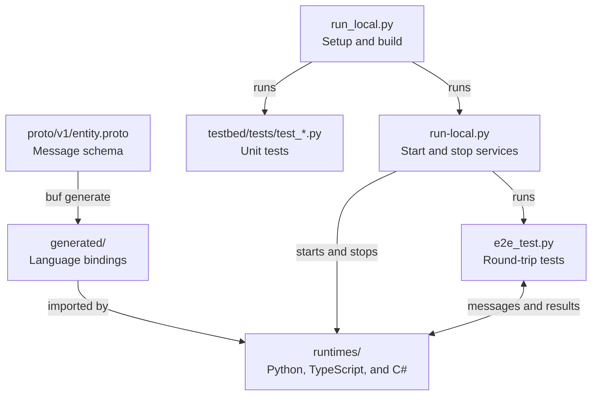
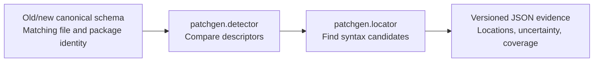

# Schema Sentinel Lab

Independent personal working checkout, retaining the project's inherited history.
The new [descriptor and runtime impact pipeline](docs/patch-generation/independent-pipeline.md)
compares matching schema identities, scans Python/TypeScript/C#, and feeds the
review-only patch generator. See [measured results](docs/patch-generation/independent-results.md)
for the bounded scope and retained failures. Human approval is required for every
proposed patch. The inherited testbed instructions follow.

The [live model evaluation](docs/live-model-evaluation-2026-11-02.md) records
0/6 validated proposals for both Ministral 3 3B and 8B with prompt 2.5, and
0/6 for 8B with prompt 2.8. A bounded rename-feedback probe also failed.
Successful deterministic demos are separate evidence. See the
[model reassessment](docs/model-shortlist-2026-11-02.md) for the next comparisons.

For the complete independent proposal/validation/review path, see the
[one-command demo](docs/patch-generation/demo.md):

```sh
python3.13 run_demo.py --output patchgen/evidence/my-demo
```

Install the prerequisites listed in that guide first. This bounded deterministic
demo makes zero model calls and leaves human approval pending.
Use `--case pubsub-utf8` (also `pubsub-rename` or `pubsub-removal`) to add
three-runtime fan-out and a truncated-payload negative control. For the standalone
pub/sub testbed, see [testbed development](testbed/README.md).


UCF Senior Design project for testing schema changes across Python, TypeScript,
and C#. The testbed sends one Protobuf `Entity` through all three services and
checks that each service reads the same `entity_id` and `name`.

## Run locally

Install these tools, then reopen your terminal:

| Tool | Version |
| --- | --- |
| [Python](https://www.python.org/downloads/) | 3.10 or newer |
| [Node.js and npm](https://nodejs.org/en/download) | Node.js 22 or newer |
| [.NET SDK](https://dotnet.microsoft.com/en-us/download/dotnet/8.0) | 8.0 SDK |

Open the project folder in your editor, then run the command below in its terminal.

### Windows (PowerShell or Command Prompt)

```powershell
py run_local.py
```

If `py` is unavailable, use `python run_local.py`.

### macOS and Linux

```sh
python3 run_local.py
```

The script installs the project dependencies, builds the runtimes, runs the unit
tests, and sends four test messages through Python -> TypeScript -> C#. It stops
the services when finished. Docker, Make, and Buf are not needed for this run.
The first run needs an internet connection to download dependencies.

Each case shows the input, encoded Protobuf bytes in hex, the values decoded by
each service, and the returned bytes and fields. PASS results confirm that the
decoded values and service order match the expectations. For example:

```text
[PASS] 1/4 - Standard text
  Input: entity_id="roundtrip-001", name="Sensor A"
  Encoded request (25 bytes, hex):
    0a 0d 72 6f 75 6e 64 74 72 69 70 2d 30 30 31 12
    08 53 65 6e 73 6f 72 20 41
  Decoded by each service:
    Python [PASS]: entity_id="roundtrip-001", name="Sensor A"
    TypeScript [PASS]: entity_id="roundtrip-001", name="Sensor A"
    C# [PASS]: entity_id="roundtrip-001", name="Sensor A"
  Encoded response (25 bytes, hex):
    0a 0d 72 6f 75 6e 64 74 72 69 70 2d 30 30 31 12
    08 53 65 6e 73 6f 72 20 41
  Decoded response [PASS]: entity_id="roundtrip-001", name="Sensor A"
  Service order [PASS]: Python -> TypeScript -> C#
```

The empty-string case encodes to zero bytes because Protobuf omits default string
values. The decoders still read both fields as empty strings.

The final line should read `PASS: 4/4 round-trip cases passed.`

To repeat the checks without reinstalling dependencies, add `test` to the command.
To keep the services running for development, add `start`. Press Ctrl+C to stop them.

## Common setup problems

- **Missing `node`, `npm`, or `dotnet`:** install the tools above and reopen the
  terminal. For .NET, choose the **8.0 SDK**, not just the runtime.
- **Python is missing:** install Python. On Windows, enable its command-line
  shortcuts; on Linux, your distribution may also require `python3-venv`.
- **`run_local.py` is missing:** run from the project folder containing this README
  and `run_local.py`.
- **A port is unavailable:** stop the program using ports 8000, 8001, or 8002.
- **A service fails:** check its log in `testbed/artifacts/`.

## Project files

The schema defines the message. Generated code lets each language read and write
it. The launcher builds the project, then runs the tests and services.



The service runner is `testbed/scripts/run-local.py`; the tests live in `testbed/tests/`.
The message route is `e2e_test.py -> Python :8000 -> TypeScript :8001 -> C# :8002`.
The response returns along the same path. Each service records the fields it
decoded, and the test checks those values, the returned message, and service order.
Generated bindings are already committed; the normal local run does not need Buf.

Deterministic analysis runs separately from the runtime testbed:



`run_local.py` does not run the impact locator. See the
[impact locator guide](docs/impact-locator.md) for its setup and current limits.

- `proto/`: v1 has `entity_id` and `name`; v2 removes `name`.
- `generated/`: Protobuf bindings used by the runtimes.
- `runtimes/`: Python, TypeScript, and C# service code.
- `testbed/`: tests, logs, and the local service runner.

See [testbed development](testbed/README.md) for individual service commands and
optional Docker commands. The [impact locator guide](docs/impact-locator.md)
covers the current descriptor and Tree-sitter pipeline and its limitations.

For a distinct buildable telemetry migration, run `run_demo.py --case telemetry-rename`
(or add `--local-codegen` after installing the pinned tools in
[tools/codegen](tools/codegen/README.md)). It checks float32 producer/consumer bytes,
renamed observations and a speed threshold in all three languages. See
[decision 0015](docs/decisions/0015-buildable-telemetry-benchmark.md) for evidence and scope.
`--case telemetry-precision` exercises float32-to-float64 serialization and
near-threshold precision across 33 runtime/case checks, with coordinated rollout
required for the wire-type change.
`--case telemetry-units` applies an explicitly supplied m/s-to-km/h policy to
producers, observations and thresholds. The structural detector does not infer
units. All three telemetry demos leave human review pending.

Run the distinct authored migrations sequentially with:

```sh
python3.13 run_benchmark.py --local-codegen --output patchgen/evidence/NEW-suite
```

The suite retains every case and reports structural classification, candidate-site
recall, runtime validation and prepared-demo timing. See
[decision 0018](docs/decisions/0018-six-migration-suite.md) for prerequisites,
denominators and limits. These deterministic cases do not establish live model
performance or meet the twenty-case benchmark target.

`run_demo.py --case inventory-width --local-codegen` validates exact signed int64
stock quantities across the three runtimes, including values above JavaScript's
safe-integer range. See
[decision 0020](docs/decisions/0020-inventory-integer-width-migration.md).
`run_demo.py --case inventory-zigzag --local-codegen` changes signed int32 wire
encoding while preserving decimal-string JSON and stock decisions. It checks
regenerated producer and consumer bytes across three languages. Coordinate the
wire change before deploying it.
See [decision 0028](docs/decisions/0028-inventory-zigzag-wire-migration.md).

The [manual baseline protocol](docs/patch-generation/manual-baseline.md)
packages the telemetry units task for an independent participant and evaluates
their patch with the same pinned runtime checks.

`run_demo.py --case inventory-stock-release --local-codegen` adds a released
stock enum state and updates all three consumers' eligibility checks. Quarantined
and unknown values remain blocked. The suite includes this pinned
policy while the generic enum analysis remains candidate-only.

`run_demo.py --case inventory-presence --local-codegen` migrates inventory
quantity to explicit proto3 presence. The tenth suite case checks absent and
explicit-zero values at both wire and JSON boundaries across the three runtimes.
See [decision 0030](docs/decisions/0030-inventory-quantity-presence.md).

`run_demo.py --case inventory-labels --local-codegen` collapses repeated
display labels into one value. It checks last-label selection and old repeated
wire inputs across the three runtimes.
See [decision 0031](docs/decisions/0031-inventory-display-labels.md).

`run_demo.py --case inventory-reservation --local-codegen` adds a reserved
quantity with a zero default and checks the new availability rule across the
three runtimes. See [decision 0032](docs/decisions/0032-inventory-reservation.md).

`run_demo.py --case telemetry-quantized --local-codegen` changes telemetry
speed from float32 to a saturated, truncated int32 and checks the resulting
wire values and threshold decisions across all three runtimes.
See [decision 0033](docs/decisions/0033-telemetry-speed-quantization.md).

`run_demo.py --case inventory-state-rename --local-codegen` changes the
opted-in symbolic stock state label to `ON_HOLD` while preserving numeric
wire values and eligibility. See [decision 0034](docs/decisions/0034-inventory-state-rename.md).

`run_demo.py --case telemetry-message-rename --local-codegen` renames the
standalone generated telemetry type and validates unchanged raw payloads and
runtime decisions. See [decision 0035](docs/decisions/0035-telemetry-message-rename.md).
