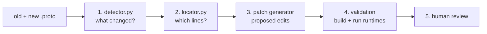

# Schema Sentinel Lab

Schema Sentinel helps when a shared data schema changes. Several programs, written in
different languages, all read and write the same Protobuf messages. When someone edits
the `.proto` schema, every one of those programs may need a code change. Schema Sentinel:

1. **Detects the change.** It compares the old and new schema and says exactly what changed.
2. **Locates the impact.** It finds the lines of runtime code that may need editing.
3. **Drafts a patch.** It proposes the code edits, either from a fixed recipe or with an LLM.
4. **Validates the patch.** It builds and runs all three runtimes to check them.
5. **Asks a human.** A person approves or rejects every patch. Nothing is merged automatically.

The runtimes are small mock services in **Python**, **TypeScript** and **C#** (in `runtimes/`).



## Try it: see change detection and impact location

This runs only steps 1 and 2. It needs no model, no services and no internet after setup.

You need **Python 3.13**, **[Buf](https://buf.build/docs/installation)** (macOS:
`brew install bufbuild/buf/buf`) and a **full** `git clone`. A shallow clone
won't work because the examples read older commits.

```sh
python3.13 -m venv .venv
.venv/bin/pip install -r patchgen/pipeline-requirements.txt
.venv/bin/python explain_change.py
```

On Windows, use `py -3.13 -m venv .venv` and `.venv\Scripts\python` instead of `.venv/bin/python`.

The default example renames the telemetry field `speed_mps` to `ground_speed_mps`. The output
looks like this (shortened):

```text
STEP 1 - CHANGE DETECTION
  status: complete  (single_supported_event)
  compatibility: renaming
  event: {'category': 'field_renamed', 'message': 'simulation.telemetry.VehicleTelemetry',
          'field_number': 2, 'old_name': 'speed_mps', 'new_name': 'ground_speed_mps'}
    -> renaming: wire bytes unchanged; generated names and JSON keys change

STEP 2 - IMPACT LOCATION
  status: complete   files scanned: 6

  runtimes/python/telemetry_runtime.py
    line  10 [bound, must edit]: sample = VehicleTelemetry(vehicle_id=..., speed_mps=request['speed'])
             why: keyword_argument
  ...
```

More ways to run it:

```sh
.venv/bin/python explain_change.py --list                       # all example changes
.venv/bin/python explain_change.py --fixture entity-name-removal  # pick one
.venv/bin/python explain_change.py --json                       # full machine-readable records
.venv/bin/python explain_change.py --old my_old.proto --new my_new.proto --schema-path proto/v1/entity.proto
```

Each example lives in `patchgen/fixtures/<name>/runtime-input.json`. It holds the old schema,
the new schema, the git commit of the runtime code to scan, and a sentence describing what
the change should mean.

## How the code works

### Step 1: change detection (`patchgen/detector.py`)

- `descriptor()` asks **Buf** to compile a `.proto` file into a *descriptor*, which is
  Protobuf's own structured description of the schema. Comparing descriptors avoids
  fragile text diffing.
- `compare(old, new)` walks messages, fields and enums and matches fields by **field
  number** (their wire identity), not by name. That is how a rename shows up as
  `field_renamed` and not as a removal plus an addition.
- Each recognized change becomes an **event** with a category such as `field_renamed`,
  `field_removed`, `field_type_changed`, `field_added`, `enum_value_added`,
  `message_renamed` and so on. Anything it doesn't fully understand goes into an
  **`unsupported`** list instead of being guessed.
- Each event also gets a **compatibility label**, using the sponsor's four classes:
  `breaking`, `renaming` (wire bytes unchanged, names change), `safe-additive` or
  `semantic-only` (only comments changed). The table is `COMPATIBILITY` in `detector.py`.
  The record's overall `compatibility` is the most severe label, or `unknown` if anything is unsupported.
- `detect()` wraps it all into one record. Status is `complete` only when there is exactly
  one supported event, nothing unsupported, and an intended-behavior sentence. Otherwise
  it is `partial` and later steps refuse to generate a patch.
- It **never guesses meaning**, but it does report changed `.proto` comments
  (`comment_changes`, `semantic_review`). A change from m/s to km/h looks like a plain rename,
  so the changed comment ("meters per second" → "kilometers per hour") is the only clue
  that a person needs to check the units. The intended-behavior text has to say what to do.

### Step 2: impact location (`patchgen/locator.py`)

- `runtime_inventory.py` lists every tracked file under `runtimes/` at the chosen commit.
  Unknown file types make the result `partial`, because a file it can't read might hide an impact.
- `scan()` parses each Python, TypeScript and C# file with **Tree-sitter**, a real parser,
  and marks lines that mention the field. It checks every spelling the generated code can
  use (`speed_mps`, `speedMps`, `SpeedMps`), string keys like `"speed_mps"`, and risky
  patterns such as reflection (`getattr`, `GetProperty`) or dynamic `obj[key]` access.
- These lines are **candidates**: "look here", not "this is definitely affected". The
  design favors recall, because a missed site is worse than an extra one.
- `python_bindings.py` and `typescript_bindings.py` add stronger **binding evidence**. They
  follow imports of the generated Protobuf class, so the locator can say "this line really
  uses `VehicleTelemetry.speed_mps`" (`[bound]`) and "this line must be edited"
  (`[bound, must edit]`). C# lines stay plain candidates.
- `locate()` returns one record: the scanned files with their hashes, the candidate lines
  with reasons, and any issues.

### Steps 3 to 5: patch generation, validation and review

`patchgen/pipeline.py` runs the whole chain. `adapter.py` re-checks the detector and locator
records. `generator.py` drafts and validates a patch, using either a per-case deterministic
recipe (files such as `type_utf8.py` and `inventory_width.py`) or an LLM. `review.py` exports
a local review page. The one-command demo is `run_demo.py`, explained in
[docs/patch-generation/demo.md](docs/patch-generation/demo.md). Model work is documented in
[docs/patch-generation/](docs/patch-generation/) and [docs/decisions/](docs/decisions/).

## Run the three runtimes (testbed)

Needs Python 3.10+, Node.js 22+ and the .NET 8 SDK.

```sh
python3 run_local.py
```

(Windows: `py run_local.py`.) This installs the dependencies, builds everything, runs the unit
tests, and sends four test messages Python -> TypeScript -> C# and back. The last line should be
`PASS: 4/4 round-trip cases passed.` Add `test` to rerun without reinstalling, or `start` to
keep the services running. See [testbed/README.md](testbed/README.md) for more.

## Run the tests

```sh
.venv/bin/python -m unittest discover -s patchgen/tests       # analysis + patch generation (~40 s)
.venv/bin/python -m unittest discover -s testbed/tests -p 'test_*.py'
```

Good starting tests for steps 1 and 2: `test_detector_boundaries.py`, `test_pipeline.py`,
`test_python_bindings.py`, `test_typescript_bindings.py` and `test_source_spellings.py`.

## Where things are

| Path | What it is |
| --- | --- |
| `proto/` | The schemas: `v1`/`v2` Entity, `telemetry`, `inventory` |
| `generated/` | Code that Buf generates from `proto/` for each language. Don't edit it by hand |
| `runtimes/` | The Python, TypeScript and C# mock services that the locator scans |
| `explain_change.py` | Runs steps 1 and 2 and prints the result in plain text |
| `patchgen/detector.py` | Step 1: change detection |
| `patchgen/locator.py` | Step 2: impact location, plus the `*_bindings.py`, `source_spellings.py` and `runtime_inventory.py` helpers |
| `patchgen/pipeline.py`, `generator.py`, `review.py` | Steps 3 to 5 |
| `patchgen/fixtures/` | Example change requests (input) |
| `patchgen/reference/` | Known-correct answers, used only for scoring after a run |
| `patchgen/corpus/` | Extra authored scenarios (orders, inventory, telemetry) for testing steps 1 and 2 |
| `patchgen/tests/`, `testbed/tests/` | Unit tests |
| `run_local.py`, `testbed/` | The runtime testbed and its launcher |
| `run_demo.py`, `run_benchmark.py`, `run_manual_baseline.py` | End-to-end demo, 20-case benchmark, and manual baseline |
| `docs/decisions/` | Numbered design decisions (why things are the way they are) |
| `docs/history/` | Old dated reports. Not needed to understand the code |

Run outputs go to `patchgen/evidence/`, which git ignores. Older committed runs were
removed to keep the repo small. They are still available under the git tag
`archive/pre-cleanup-2026-11-10`.
