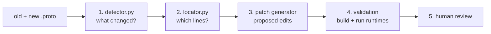

# Schema Sentinel Lab

Schema Sentinel helps when a shared data schema changes. Several programs, written in
different languages, all read and write the same Protobuf messages. When someone edits
the `.proto` schema, every one of those programs may need a code change. Schema Sentinel:

1. **Detects the change.** It compares the old and new schema and says exactly what changed.
2. **Locates the impact.** It finds the lines of runtime code that may need editing.
3. **Drafts a patch.** It proposes the code edits, either from a fixed recipe or with an LLM.
4. **Validates the patch.** It builds and runs all three runtimes to check them.
5. **Asks a human.** A person approves or rejects every patch. Nothing is merged automatically.

The runtimes are small mock services in **Python**, **TypeScript** and **C#** (in `runtimes/`).



## Try it: see change detection and impact location

This runs only steps 1 and 2. It needs no model, no services and no internet after setup.

You need **Python 3.13**, **[Buf](https://buf.build/docs/installation)** (macOS:
`brew install bufbuild/buf/buf`) and a **full** `git clone`. A shallow clone
won't work because the examples read older commits.

```sh
python3.13 -m venv .venv
.venv/bin/pip install -r patchgen/pipeline-requirements.txt
.venv/bin/python explain_change.py
```

On Windows, use `py -3.13 -m venv .venv` and `.venv\Scripts\python` instead of `.venv/bin/python`.

The default example renames the telemetry field `speed_mps` to `ground_speed_mps`. The output
looks like this (shortened):

```text
STEP 1 - CHANGE DETECTION
  status: complete  (single_supported_event)
  compatibility: renaming
  event: {'category': 'field_renamed', 'message': 'simulation.telemetry.VehicleTelemetry',
          'field_number': 2, 'old_name': 'speed_mps', 'new_name': 'ground_speed_mps'}
    -> renaming: wire bytes unchanged; generated names and JSON keys change

STEP 2 - IMPACT LOCATION
  status: complete   files scanned: 6

  runtimes/python/telemetry_runtime.py
    line  10 [bound, must edit]: sample = VehicleTelemetry(vehicle_id=..., speed_mps=request['speed'])
             why: keyword_argument
  ...
```

More ways to run it:

```sh
.venv/bin/python explain_change.py --list                       # all example changes
.venv/bin/python explain_change.py --fixture entity-name-removal  # pick one
.venv/bin/python explain_change.py --json                       # full machine-readable records
.venv/bin/python explain_change.py --old my_old.proto --new my_new.proto --schema-path proto/v1/entity.proto
```

Each example lives in `patchgen/fixtures/<name>/runtime-input.json`. It holds the old schema,
the new schema, the git commit of the runtime code to scan, and a sentence describing what
the change should mean.

## How the code works

### Step 1: change detection (`patchgen/detector.py`)

- `descriptor()` asks **Buf** to compile a `.proto` file into a *descriptor*, which is
  Protobuf's own structured description of the schema. Comparing descriptors avoids
  fragile text diffing.
- `compare(old, new)` walks messages, fields and enums and matches fields by **field
  number** (their wire identity), not by name. That is how a rename shows up as
  `field_renamed` and not as a removal plus an addition.
- Each recognized change becomes an **event** with a category such as `field_renamed`,
  `field_removed`, `field_type_changed`, `field_added`, `enum_value_added`,
  `message_renamed` and so on. Anything it doesn't fully understand goes into an
  **`unsupported`** list instead of being guessed.
- Each event also gets a **compatibility label**, using the sponsor's four classes:
  `breaking`, `renaming` (wire bytes unchanged, names change), `safe-additive` or
  `semantic-only` (only comments changed). The table is `COMPATIBILITY` in `detector.py`.
  The record's overall `compatibility` is the most severe label, or `unknown` if anything is unsupported.
- `detect()` wraps it all into one record. Status is `complete` only when there is exactly
  one supported event, nothing unsupported, and an intended-behavior sentence. Otherwise
  it is `partial` and later steps refuse to generate a patch.
- It **never guesses meaning**, but it does report changed `.proto` comments
  (`comment_changes`, `semantic_review`). A change from m/s to km/h looks like a plain rename,
  so the changed comment ("meters per second" → "kilometers per hour") is the only clue
  that a person needs to check the units. The intended-behavior text has to say what to do.

### Step 2: impact location (`patchgen/locator.py`)

- `runtime_inventory.py` lists every tracked file under `runtimes/` at the chosen commit.
  Unknown file types make the result `partial`, because a file it can't read might hide an impact.
- `scan()` parses each Python, TypeScript and C# file with **Tree-sitter**, a real parser,
  and marks lines that mention the field. It checks every spelling the generated code can
  use (`speed_mps`, `speedMps`, `SpeedMps`), string keys like `"speed_mps"`, and risky
  patterns such as reflection (`getattr`, `GetProperty`) or dynamic `obj[key]` access.
- These lines are **candidates**: "look here", not "this is definitely affected". The
  design favors recall, because a missed site is worse than an extra one.
- `python_bindings.py` and `typescript_bindings.py` add stronger **binding evidence**. They
  follow imports of the generated Protobuf class, so the locator can say "this line really
  uses `VehicleTelemetry.speed_mps`" (`[bound]`) and "this line must be edited"
  (`[bound, must edit]`). C# lines stay plain candidates.
- `locate()` returns one record: the scanned files with their hashes, the candidate lines
  with reasons, and any issues.

## Patch generation, validation and review (steps 3 to 5)

Once both records are `complete`, the tool drafts a code change for every candidate file,
applies it to an isolated copy of the repo, proves it works by building and running all
three runtimes, and hands the result to a person. **It never merges anything by itself.**

### How a patch is made

1. **Check the inputs** (`patchgen/adapter.py`). The adapter re-runs the detector and the
   locator scan on the pinned source and refuses records that don't match. It then writes
   `input.json`, the request for the patch generator.
2. **Draft the edits** (`patchgen/generator.py`). It makes one request per affected file.
   That request holds the intended behavior, the old and new schema, the file's source and
   the candidate lines. Answer keys and test files are never sent. The draft comes from one
   of two sources:
    - **An LLM**, via one of the `candidate_*` strategies. The model must return exact
      before/after code blocks for the candidate lines, plus a rationale and a confidence.
      The host checks every block (`anchor_edits.py`) and rejects any answer that edits
      something it shouldn't, skips a required line, or isn't valid JSON.
    - **A deterministic recipe**, via a `deterministic_*` strategy. This is a hand-written,
      per-case policy such as `type_utf8.py`, `inventory_width.py` or `telemetry_units.py`.
      It makes no model calls. These recipes prove that the validation and review path
      works, and they are never counted as model successes.
3. **Apply it in isolation.** The host checks the paths and the patch shape (no new,
   deleted, renamed or binary files), creates a detached git worktree under the output
   folder, runs `git apply --check`, and applies the patch there. Your checkout is never touched.
4. **Validate** (the gate). It regenerates the Protobuf bindings (`buf generate`, or pinned
   local tools with `--local-codegen`). Then `run_local.py` builds all three runtimes, runs
   the unit tests and the Python → TypeScript → C# round trip. Last comes an
   **independent oracle** written by us, not the model: `patchgen/oracle.py`,
   `patchgen/benchmark_oracle.py`, or the telemetry, inventory and pub/sub checkers in
   `testbed/`. These send real encoded messages and check every runtime's decoded values
   and decisions. A patch is `validation_passed` only if every step passes.
5. **Review** (`patchgen/review.py`). This exports a local web page with the intended
   behavior, the full diff and all validation evidence. A person types their name and
   reason and downloads an approve/reject decision file, and `review verify` checks it.
   A failed patch can only be rejected. Nothing is applied to the real repo or merged.

### The model setup (locked)

Model choice was frozen on 5 Nov 2026 ([decision 0041](docs/decisions/0041-locked-gemma-configuration.md)).
The setup is **Gemma 4 31B (`google/gemma-4-31b-it`) on NVIDIA's hosted API**, strategy
`candidate_semantic_blocks` (prompt 3.1), temperature 0.5, seed 0. `--locked` selects exactly
this setup and refuses any override. Prompt, sampling and parser fingerprints are checked
on every run, so silent prompt tuning is caught.

- **API key:** set `NVIDIA_API_KEY`, or run `.venv/bin/python -m patchgen.nvidia_client setup-key`
  once. That stores it in `~/.config/schema-sentinel/nvidia.key`, outside the repo.
- Without `--locked`, the CLI default is still local **Ollama** (Ministral 3 models), so
  nothing calls a hosted model unless you ask for it. OpenRouter and other NVIDIA models
  remain as recorded experiments.
- **Repair loop** (`patchgen/repair_suite.py`, [decision 0042](docs/decisions/0042-bounded-repair-loop.md)):
  for each rejected case, the compiler errors and a fixed-wording oracle verdict are sent
  back for **at most two rounds**. Expected values, reference answers and test-file errors
  are never sent. First-pass and repaired results are reported separately.

### Results so far

| What | Result | Source |
| --- | --- | --- |
| Deterministic recipes, 20 authored migrations | 20/20 validated; all 137 expected impact sites found (+61 extra candidates) | [20-case report](docs/history/twenty-case-evaluation.md), [decision 0036](docs/decisions/0036-twenty-migration-benchmark.md) |
| Local Ministral 3 (3B, 8B) | 0/6 on the first six cases; 8B 0/8 on the eight model-eligible cases | [model report](docs/history/live-model-evaluation-2026-11-02.md), [20-case report](docs/history/twenty-case-evaluation.md) |
| NVIDIA comparison (8 model-eligible cases) | Nemotron Ultra 2/8 → 5/8 as prompts improved; Gemma 6/8; Laguna 2/8 | [decision 0038](docs/decisions/0038-nvidia-model-prompt-evaluation.md), [decision 0039](docs/decisions/0039-laguna-coding-model-trial.md) |
| Locked Gemma, first pass | 6/8 validated | [decision 0042](docs/decisions/0042-bounded-repair-loop.md) |
| Locked Gemma + repair loop | 7/8 within one round (33 requests in total) | [decision 0042](docs/decisions/0042-bounded-repair-loop.md) |

**Caveat:** all eight model cases were also used while developing the prompt, so 6/8 and 7/8
are *development* numbers, not proof the model works on new changes. The fix is **held-out
cases**: new migrations written after the lock, approved by someone who hasn't seen the model's
failures, sealed, and scored once. The runner exists (`patchgen/held_out.py`,
`live_suite --locked --held-out`), but no held-out cases exist yet. See the
[held-out plan](docs/patch-generation/held-out-plan.md). Human review time has not been measured yet.

### Run it

You need the `.venv` from "Try it" above, plus Node.js 22+ and the .NET 8 SDK (validation
builds all three runtimes), internet access for dependencies, and free ports 8000–8002. Each
run needs a new output folder.

```sh
# Full deterministic demo (no model, no API key): detect, locate, patch, validate, review page
python3.13 run_demo.py --output patchgen/evidence/my-demo
python3.13 run_demo.py --case telemetry-units --output patchgen/evidence/my-units-demo

# All 20 authored migrations, one after another (pinned local code generators: tools/codegen/README.md)
python3.13 run_benchmark.py --local-codegen --output patchgen/evidence/my-benchmark

# The locked LLM evaluation, then the repair loop on its failures (needs the NVIDIA key)
.venv/bin/python -m patchgen.live_suite --locked --full-benchmark --output patchgen/evidence/my-locked
.venv/bin/python -m patchgen.repair_suite --source patchgen/evidence/my-locked --output patchgen/evidence/my-repair

# Look at a result and record a decision
.venv/bin/python -m http.server 8765 --bind 127.0.0.1 --directory patchgen/evidence
#   open http://127.0.0.1:8765/my-demo/review/index.html, decide, download review-decision.json
.venv/bin/python -m patchgen.review verify --bundle patchgen/evidence/my-demo/review --decision ~/Downloads/review-decision.json
```

`run_demo.py --help` lists all 23 demo cases. `run_manual_baseline.py` packages one task for a
person to do by hand, for the human-versus-tool comparison
([guide](docs/patch-generation/manual-baseline.md)). More detail is in
[docs/patch-generation/](docs/patch-generation/): [demo](docs/patch-generation/demo.md),
[review](docs/patch-generation/review.md) and [contract](docs/patch-generation/contract.md).

## Run the three runtimes (testbed)

Needs Python 3.10+, Node.js 22+ and the .NET 8 SDK.

```sh
python3 run_local.py
```

(Windows: `py run_local.py`.) This installs the dependencies, builds everything, runs the unit
tests, and sends four test messages Python -> TypeScript -> C# and back. The last line should be
`PASS: 4/4 round-trip cases passed.` Add `test` to rerun without reinstalling, or `start` to
keep the services running. See [testbed/README.md](testbed/README.md) for more.

## Run the tests

```sh
.venv/bin/python -m unittest discover -s patchgen/tests       # analysis + patch generation (~40 s)
.venv/bin/python -m unittest discover -s testbed/tests -p 'test_*.py'
```

Good starting tests for steps 1 and 2: `test_detector_boundaries.py`, `test_compatibility.py`,
`test_pipeline.py`, `test_python_bindings.py`, `test_typescript_bindings.py` and `test_source_spellings.py`.
For steps 3 to 5: `test_generator.py`, `test_anchor_edits.py`, `test_live_suite.py`,
`test_repair_suite.py`, `test_held_out.py` and `test_review.py`.

## Where things are

| Path | What it is |
| --- | --- |
| `proto/` | The schemas: `v1`/`v2` Entity, `telemetry`, `inventory` |
| `generated/` | Code that Buf generates from `proto/` for each language. Don't edit it by hand |
| `runtimes/` | The Python, TypeScript and C# mock services that the locator scans |
| `explain_change.py` | Runs steps 1 and 2 and prints the result in plain text |
| `patchgen/detector.py` | Step 1: change detection |
| `patchgen/locator.py` | Step 2: impact location, plus the `*_bindings.py`, `source_spellings.py` and `runtime_inventory.py` helpers |
| `patchgen/pipeline.py`, `adapter.py` | Run the whole chain; check the detector and locator records before drafting |
| `patchgen/generator.py`, `anchor_edits.py`, `feedback_blocks.py` | Step 3 (draft and apply) and step 4 (validate) |
| `patchgen/type_utf8.py`, `inventory_*.py`, `telemetry_*.py`, `remove_name.py`, ... | Deterministic per-case recipes (no model) |
| `patchgen/nvidia_client.py` | Hosted model access for the locked Gemma setup (`openrouter_client.py` is an older experiment) |
| `patchgen/live_suite.py`, `repair_suite.py`, `held_out.py` | LLM evaluation, repair loop, held-out sealing |
| `patchgen/oracle.py`, `benchmark_oracle.py`, `testbed/{telemetry,inventory,pubsub}/` | Independent checkers used by validation |
| `patchgen/review.py`, `review_assets/` | Step 5: review page export and decision check |
| `tools/codegen/` | Pinned local Protobuf code generators (`--local-codegen`) |
| `patchgen/fixtures/` | Example change requests (input) |
| `patchgen/reference/` | Known-correct answers, used only for scoring after a run |
| `patchgen/corpus/` | Extra authored scenarios (orders, inventory, telemetry) for testing steps 1 and 2 |
| `patchgen/tests/`, `testbed/tests/` | Unit tests |
| `run_local.py`, `testbed/` | The runtime testbed and its launcher |
| `run_demo.py`, `run_benchmark.py`, `run_manual_baseline.py` | End-to-end demo, 20-case benchmark, and manual baseline |
| `docs/decisions/` | Numbered design decisions (why things are the way they are) |
| `docs/history/` | Old dated reports. Not needed to understand the code |

Run outputs go to `patchgen/evidence/`, which git ignores. Older committed runs were
removed to keep the repo small. They are still available under the git tag
`archive/pre-cleanup-2026-11-10`.
